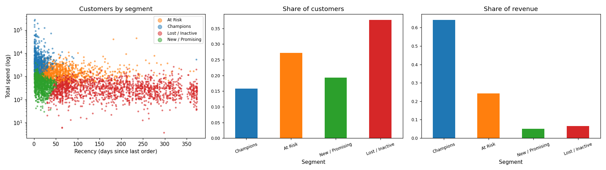
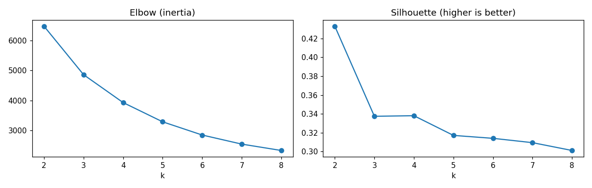

# Evaluation Report: Customer Segmentation

## Data and cleaning
- UCI Online Retail: 541,909 transaction lines, 2011-12-10 snapshot.
- Removed: 135,080 lines without a customer ID, 8,905 cancellations,
  40 lines with zero/negative quantity or price,
  1,547 postage/fee lines, 5,187 duplicates.
- 391,150 clean lines -> 4,334 customers.

## Method
- RFM per customer: Recency (days since last order), Frequency (number of orders), Monetary (total spend).
- log(1+x) transform and standard scaling (the raw values are extremely skewed).
- Number of segments: K-Means scan of k = 2..8 (elbow, silhouette, Davies-Bouldin); best silhouette
  among 4-6 segments -> **K = 4**.
- Algorithms compared at K = 4: K-Means, Gaussian Mixture, Agglomerative (Ward).

## Results
| model | silhouette | davies_bouldin | calinski_harabasz | smallest_segment_pct | can_score_new_customers |
|---|---|---|---|---|---|
| K-Means | 0.3381 | 1.0131 | 3,329.6842 | 0.1583 | True |
| Gaussian Mixture | 0.1752 | 1.7082 | 2,167.7132 | 0.1917 | True |
| Agglomerative (Ward) | 0.2428 | 1.2255 | 2,780.0958 | 0.1461 | False |

**Selected: K-Means** (best silhouette among models that can score new customers).

### Segments
| Segment | customers | median_recency_days | median_orders | median_spend | total_revenue | customers_pct | revenue_pct | action |
|---|---|---|---|---|---|---|---|---|
| Champions | 686 | 8.0 | 10.0 | 3,728.76 | 5,603,729.81 | 0.158 | 0.641 | Reward them: VIP perks, early access to new products, ask for reviews and referrals. |
| At Risk | 1177 | 52.0 | 4.0 | 1,356.33 | 2,115,806.44 | 0.272 | 0.242 | Win-back campaign now: personal email, time-limited offer, ask what went wrong. |
| New / Promising | 835 | 17.0 | 2.0 | 460.64 | 444,977.54 | 0.193 | 0.051 | Onboarding emails, a second-purchase discount, show best-sellers. |
| Lost / Inactive | 1636 | 176.5 | 1.0 | 298.44 | 572,713.85 | 0.377 | 0.066 | Low-cost reactivation (newsletter, big seasonal sale); do not overspend. |

## Limitations
- Clustering has no "correct answer"; the metrics show the groups are reasonably separated, and the
  segment names are rules on the group medians that marketing should review.
- One year of data from one UK gift retailer (many customers are wholesalers); segments should be
  refitted on the client's own customers.
- Recency depends on the snapshot date; re-score customers regularly (e.g. monthly).
- RFM ignores what customers buy, discounts and returns; product-category features could be added later.
